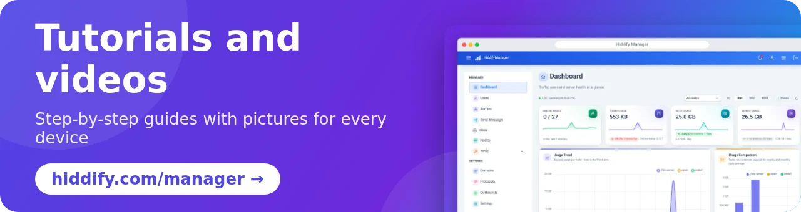

<base target="_blank">

<div dir="ltr" align=center>

[**فارسی 🇮🇷**](docs/README_fa.md) / [**Русский 🇷🇺**](docs/README_ru.md) / [**简体中文 🇨🇳**](docs/README_cn.md) &nbsp;&nbsp; [](https://hiddify.com/manager/) [](https://github.com/hiddify/hiddify-manager/discussions/categories/q-a-%D8%B3%D9%88%D8%A7%D9%84%D8%A7%D8%AA-%D8%B1%D8%A7%DB%8C%D8%AC) [](https://github.com/hiddify/hiddify-manager/issues)

</div>
<br>

<div align=center>


</div>
<br>

<div align=center>

[](https://www.pepy.tech/projects/hiddifypanel) [](https://github.com/hiddify/hiddify-manager/releases) [](https://github.com/hiddify/hiddify-manager/releases) [](https://github.com/hiddify/hiddify-manager/commits/) [](https://www.youtube.com/@hiddify) [](https://telegram.dog/hiddify) [](https://telegram.dog/hiddify_board/5) [](https://gurubase.io/g/hiddify-manager)

</div>

<div dir="ltr" markdown="1">

## Welcome to Hiddify Manager

Hiddify Manager is a free and open-source anti-censorship panel that you install on your own server. It runs a multi-user VPN and proxy server with **more than 20 protocols**, including **Reality** and a **Telegram proxy**, and gives you a modern web panel to manage your users, domains and settings. It is tuned for heavy filtering in **Iran, China and Russia**, and is listed by [Xray](https://github.com/XTLS/Xray-core#installation).

<div align=center>

</div>

### Table of contents

- [Quick install](#quick-install)
- [Why Hiddify Manager?](#why-hiddify-manager)
  - [Main features](#main-features)
  - [Supported protocols](#supported-protocols)
- [Installation and tutorials](#installation-and-tutorials)
- [Acknowledgements](#acknowledgements)
- [Donation and support](#donation-and-support)
- [Collaboration and contact](#collaboration-and-contact)

## Quick install

You need a server (VPS) with **Ubuntu 22.04, 24.04 or 26.04** (amd64 or arm64), at least **1 GB RAM, 1 CPU core and 10 GB of storage**. Connect to the server over SSH and run:

```bash
bash <(curl https://i.hiddify.com/release)
```

At the end, the installer shows your admin link. Open it, follow the quick setup, and add your first user. The [installation guide](https://hiddify.com/manager/installation-and-setup/guide/) explains every step; there are also one-click guides for [Hetzner](https://hiddify.com/manager/installation-and-setup/Quick-installation-on-Hetzner-Servers/), [Oracle Cloud](https://hiddify.com/manager/installation-and-setup/Quick-Installation-on-Oracle-Cloud/), [Azure](https://hiddify.com/manager/installation-and-setup/Quick-Installation-on-Microsoft-Azure/) and [cloud-init](https://hiddify.com/manager/installation-and-setup/Cloud-init-installation/).

To connect from phones and computers, we recommend the [Hiddify app](https://github.com/hiddify/hiddify-app).

## Why Hiddify Manager?

The name *Hiddify* comes from **hidden** and **simplify**: the goal is a server that is hard to detect and easy to run.

### Main features

- 🖥 **Modern admin panel (Admin V2)** in 28 languages, with light and dark themes, that also works on phones.
- ⚡ **Quick installation** and a guided first setup; **automatic updates** and **automatic backups** (also sent to you on Telegram).
- 🧠 **Xray and sing-box cores** together, with **smart routing** that keeps domestic sites off the proxy.
- 🌐 **Every kind of domain:** direct, CDN (Cloudflare and others), relay, subscription-only, Reality, fake and wildcard domains; automatic certificates.
- 👥 **User management:** data and time limits per user, renewals, tags, and **three admin roles** (super admin, admin, agent) with per-admin limits.
- 📱 **Personal user page** for each user: usage, configs, QR codes, and one-tap import into the Hiddify app and other clients.
- 🤖 **Telegram bot** for you and your users: create and manage users, server status, free test accounts, reminders and support messages.
- ✈️ **Telegram proxy** (MTProxy FakeTLS) and a **Telegram web proxy through Cloudflare**.
- 🛰 **Multi-server:** connect several servers (nodes) to one parent panel.
- 🧰 **Tools:** config tester, clean IP scanner, Reality domain scanner, WARP, firewall, DNS over HTTPS, custom outbounds and config templates.

### Supported protocols

**VLESS, VMess, Trojan, Reality, Shadowsocks (2022, ShadowTLS), Hysteria2, TUIC, WireGuard, AnyTLS, Snell, Naive, Mieru, SSH, xHTTP, gRPC, WebSocket, HTTPUpgrade,** DNS tunnels (**VayDNS, Slipstream, MasterDnsVPN**) and the **Telegram proxy**, over direct, CDN and relay domains.

## Installation and tutorials

All tutorials, with pictures and videos, are on our website:

- [Installation guide](https://hiddify.com/manager/installation-and-setup/guide/)
- [How to configure the panel properly](https://hiddify.com/manager/configuration-and-advanced-settings/How-to-configure-Hiddify-panel-properly/)
- [Domains, CDN and Cloudflare](https://hiddify.com/manager/domain-worker-cdn-and-tunneling/How-to-use-Cloudflare-CDN/)
- [All Hiddify Manager tutorials and videos](https://hiddify.com/manager/)

<div align="center">
 <a href="https://hiddify.com/manager/"></a>
</div>

## Acknowledgements

We sincerely thank the contributors of these projects; their solid foundation and features made this project possible:

- [sing-box](https://github.com/SagerNet/sing-box)
- [Xray](https://github.com/XTLS/Xray-core)
- [Linux by Linus Torvalds](https://github.com/torvalds/linux)
- Font: [Vazirmatn by Saber Rastikerdar](https://github.com/rastikerdar/vazirmatn)

## Donation and support

The easiest way to support us is to give this repository a star (⭐) at the top of this page.

<div align=center>
<a href="https://next.ossinsight.io/widgets/official/analyze-repo-stars-history?repo_id=541755332" target="_blank" style="display: block" align="center">
  <picture>
    <source media="(prefers-color-scheme: dark)" srcset="https://next.ossinsight.io/widgets/official/analyze-repo-stars-history/thumbnail.png?repo_id=541755332&image_size=auto&color_scheme=dark" width="721" height="auto">
    
  </picture>
</a>
</div>

We also need financial support for our services. All our work is voluntary, and every donation goes to the development of the project. See our [donation page](https://hiddify.com/donation-and-support/).

## Collaboration and contact

Hiddify is a community-driven project, and we need your help. If you are skilled in any of these areas, please contact us and mention your skill:

- Python development
- Vue / TypeScript development
- Go development
- Media production

<div align=center>
<br>

[](mailto:contribute@hiddify.com)
[](https://telegram.dog/hiddify)
[](https://telegram.dog/hiddify_board)
[](https://www.youtube.com/@hiddify)
[](https://twitter.com/intent/follow?screen_name=hiddify_com)

</div>

<p align=center>
We thank everyone who takes part in this project, here on GitHub and the many more outside it. It means a lot to us. ♥
</p>

<p align=center>
<a href="https://github.com/hiddify/hiddify-manager/graphs/contributors">
  
</a>
</p>
<p align=center>
Made with <a target="_blank" href="https://contrib.rocks">Contrib.Rocks</a>
</p>

</div>
