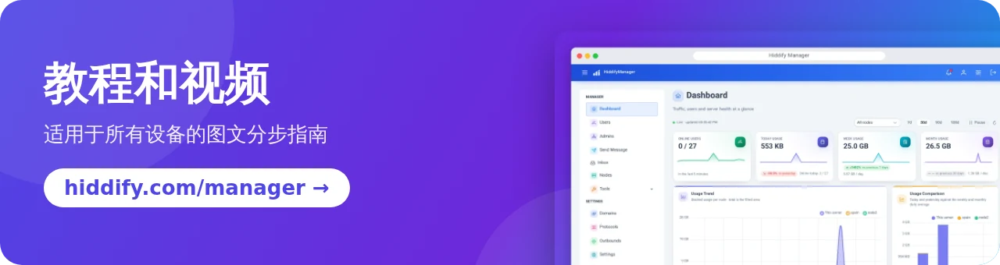

<base target="_blank">

<div dir="ltr" align=center>

[**English 🇬🇧**](../README.md) / [**فارسی 🇮🇷**](README_fa.md) / [**Русский 🇷🇺**](README_ru.md) &nbsp;&nbsp; [](https://hiddify.com/manager/) [](https://github.com/hiddify/hiddify-manager/discussions/categories/q-a-%D8%B3%D9%88%D8%A7%D9%84%D8%A7%D8%AA-%D8%B1%D8%A7%DB%8C%D8%AC) [](https://github.com/hiddify/hiddify-manager/issues)

</div>
<br>

<div align=center>


</div>
<br>

<div align=center>

[](https://www.pepy.tech/projects/hiddifypanel) [](https://github.com/hiddify/hiddify-manager/releases) [](https://github.com/hiddify/hiddify-manager/releases) [](https://github.com/hiddify/hiddify-manager/commits/) [](https://www.youtube.com/@hiddify) [](https://telegram.dog/hiddify) [](https://telegram.dog/hiddify_board/5) [](https://gurubase.io/g/hiddify-manager)

</div>

<div dir="ltr" markdown="1">

## 欢迎使用 Hiddify Manager

Hiddify Manager 是一款免费开源的反审查面板，安装在您自己的服务器上。它可以运行一个多用户 VPN 和代理服务器，支持**超过 20 种协议**，包括 **Reality** 和 **Telegram 代理**，并提供现代化的 Web 面板来管理用户、域名和设置。它针对**伊朗、中国和俄罗斯**的严格网络过滤进行了优化，并被 [Xray](https://github.com/XTLS/Xray-core#installation) 列入面板列表。

<div align=center>

</div>

### 目录

- [快速安装](#快速安装)
- [为什么选择 Hiddify Manager？](#为什么选择-hiddify-manager)
  - [主要功能](#主要功能)
  - [支持的协议](#支持的协议)
- [安装与教程](#安装与教程)
- [致谢](#致谢)
- [捐赠与支持](#捐赠与支持)
- [合作与联系](#合作与联系)

## 快速安装

您需要一台运行 **Ubuntu 22.04、24.04 或 26.04**（amd64 或 arm64）的服务器（VPS），配置至少为 **1 GB 内存、1 个 CPU 核心和 10 GB 存储空间**。通过 SSH 连接到服务器并运行：

```bash
bash <(curl https://i.hiddify.com/release)
```

安装结束时，安装程序会显示您的管理员链接。打开它，完成快速设置，然后添加您的第一个用户。[安装指南](https://hiddify.com/manager/installation-and-setup/guide/)详细说明了每一步；另外还有 [Hetzner](https://hiddify.com/manager/installation-and-setup/Quick-installation-on-Hetzner-Servers/)、[Oracle Cloud](https://hiddify.com/manager/installation-and-setup/Quick-Installation-on-Oracle-Cloud/)、[Azure](https://hiddify.com/manager/installation-and-setup/Quick-Installation-on-Microsoft-Azure/) 和 [cloud-init](https://hiddify.com/manager/installation-and-setup/Cloud-init-installation/) 的一键安装指南。

在手机和电脑上连接时，我们推荐使用 [Hiddify 应用](https://github.com/hiddify/hiddify-app)。

## 为什么选择 Hiddify Manager？

*Hiddify* 这个名字由 **hidden**（隐藏）和 **simplify**（简化）组合而成：我们的目标是打造一台难以被检测、又易于运行的服务器。

### 主要功能

- 🖥 **现代化管理面板（Admin V2）**，支持 28 种语言，提供浅色和深色主题，在手机上也能使用。
- ⚡ **快速安装**和引导式初始设置；**自动更新**和**自动备份**（备份也会通过 Telegram 发送给您）。
- 🧠 **Xray 和 sing-box 双核心**同时运行，并带有**智能路由**，让国内网站不走代理。
- 🌐 **支持各类域名**：直连、CDN（Cloudflare 等）、中转（relay）、仅订阅、Reality、伪装（fake）和通配符域名；自动申请证书。
- 👥 **用户管理**：为每个用户设置流量和时间限制、续期、标签，以及**三种管理员角色**（超级管理员、管理员、代理商），每个管理员都可单独设置限额。
- 📱 每个用户都有**个人用户页面**：用量、配置、二维码，以及一键导入 Hiddify 应用和其他客户端。
- 🤖 面向您和您的用户的 **Telegram 机器人**：创建和管理用户、查看服务器状态、免费试用账号、提醒和客服消息。
- ✈️ **Telegram 代理**（MTProxy FakeTLS）和**通过 Cloudflare 的 Telegram 网页版代理**。
- 🛰 **多服务器**：将多台服务器（节点）连接到同一个父面板。
- 🧰 **工具**：配置测试器、干净 IP 扫描器、Reality 域名扫描器、WARP、防火墙、DNS over HTTPS、自定义出站和配置模板。

### 支持的协议

**VLESS, VMess, Trojan, Reality, Shadowsocks (2022, ShadowTLS), Hysteria2, TUIC, WireGuard, AnyTLS, Snell, Naive, Mieru, SSH, xHTTP, gRPC, WebSocket, HTTPUpgrade,** DNS 隧道（**VayDNS, Slipstream, MasterDnsVPN**）以及 **Telegram proxy**，可通过直连、CDN 和中转域名使用。

## 安装与教程

所有带图片和视频的教程都在我们的网站上：

- [安装指南](https://hiddify.com/manager/installation-and-setup/guide/)
- [如何正确配置面板](https://hiddify.com/manager/configuration-and-advanced-settings/How-to-configure-Hiddify-panel-properly/)
- [域名、CDN 和 Cloudflare](https://hiddify.com/manager/domain-worker-cdn-and-tunneling/How-to-use-Cloudflare-CDN/)
- [Hiddify Manager 全部教程和视频](https://hiddify.com/manager/)

<div align="center">
 <a href="https://hiddify.com/manager/"></a>
</div>

## 致谢

我们衷心感谢以下项目的贡献者，正是他们坚实的基础和丰富的功能让本项目成为可能：

- [sing-box](https://github.com/SagerNet/sing-box)
- [Xray](https://github.com/XTLS/Xray-core)
- [Linux，作者 Linus Torvalds](https://github.com/torvalds/linux)
- 字体：[Vazirmatn，作者 Saber Rastikerdar](https://github.com/rastikerdar/vazirmatn)

## 捐赠与支持

支持我们最简单的方式，是在本页顶部为这个仓库点一个 Star（⭐）。

<div align=center>
<a href="https://next.ossinsight.io/widgets/official/analyze-repo-stars-history?repo_id=541755332" target="_blank" style="display: block" align="center">
  <picture>
    <source media="(prefers-color-scheme: dark)" srcset="https://next.ossinsight.io/widgets/official/analyze-repo-stars-history/thumbnail.png?repo_id=541755332&image_size=auto&color_scheme=dark" width="721" height="auto">
    
  </picture>
</a>
</div>

我们的服务也需要资金支持。我们的所有工作都是志愿进行的，每一笔捐赠都将用于项目的开发。请查看我们的[捐赠页面](https://hiddify.com/donation-and-support/)。

## 合作与联系

Hiddify 是一个由社区推动的项目，我们需要您的帮助。如果您擅长以下任一领域，请联系我们并说明您的技能：

- Python 开发
- Vue / TypeScript 开发
- Go 开发
- 媒体制作

<div align=center>
<br>

[](mailto:contribute@hiddify.com)
[](https://telegram.dog/hiddify)
[](https://telegram.dog/hiddify_board)
[](https://www.youtube.com/@hiddify)
[](https://twitter.com/intent/follow?screen_name=hiddify_com)

</div>

<p align=center>
感谢所有参与这个项目的人，无论是在 GitHub 上，还是在 GitHub 之外的更多朋友。这对我们意义重大。♥
</p>

<p align=center>
<a href="https://github.com/hiddify/hiddify-manager/graphs/contributors">
  
</a>
</p>
<p align=center>
使用 <a target="_blank" href="https://contrib.rocks">Contrib.Rocks</a> 制作
</p>

</div>
