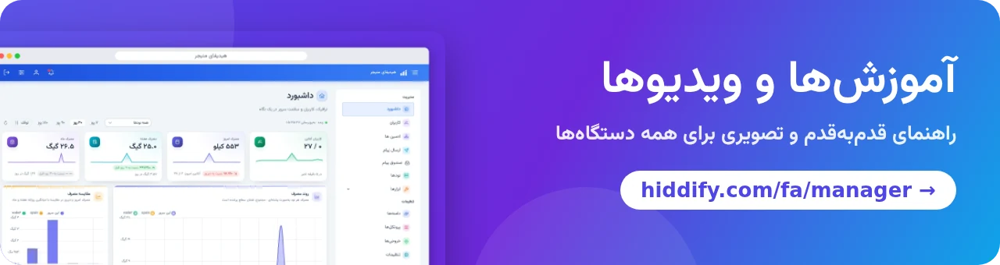

<base target="_blank">

<div dir="ltr" align=center>

[**English 🇬🇧**](../README.md) / [**Русский 🇷🇺**](README_ru.md) / [**简体中文 🇨🇳**](README_cn.md) &nbsp;&nbsp; [](https://hiddify.com/fa/manager/) [](https://github.com/hiddify/hiddify-manager/discussions/categories/q-a-%D8%B3%D9%88%D8%A7%D9%84%D8%A7%D8%AA-%D8%B1%D8%A7%DB%8C%D8%AC) [](https://github.com/hiddify/hiddify-manager/issues)

</div>
<br>

<div align=center>


</div>
<br>

<div align=center>

[](https://www.pepy.tech/projects/hiddifypanel) [](https://github.com/hiddify/hiddify-manager/releases) [](https://github.com/hiddify/hiddify-manager/releases) [](https://github.com/hiddify/hiddify-manager/commits/) [](https://www.youtube.com/@hiddify) [](https://telegram.dog/hiddify) [](https://telegram.dog/hiddify_board/5) [](https://gurubase.io/g/hiddify-manager)

</div>

<div dir="rtl" markdown="1">

## به هیدیفای‌منیجر خوش آمدید

هیدیفای‌منیجر یک پنل رایگان و متن‌باز ضدسانسور است که روی سرور خودتان نصب می‌کنید. یک سرور VPN و پروکسی چندکاربره با **بیش از ۲۰ پروتکل**، از جمله **ریالتی (Reality)** و **پروکسی تلگرام**، راه می‌اندازد و یک پنل وب مدرن برای مدیریت کاربران، دامنه‌ها و تنظیمات به شما می‌دهد. برای فیلترینگ شدید در **ایران، چین و روسیه** بهینه شده و در فهرست [Xray](https://github.com/XTLS/Xray-core#installation) آمده است.

<div align=center>

</div>

### فهرست مطالب

- [نصب سریع](#نصب-سریع)
- [چرا هیدیفای‌منیجر؟](#چرا-هیدیفایمنیجر)
  - [امکانات اصلی](#امکانات-اصلی)
  - [پروتکل‌های پشتیبانی‌شده](#پروتکلهای-پشتیبانیشده)
- [نصب و آموزش‌ها](#نصب-و-آموزشها)
- [قدردانی](#قدردانی)
- [حمایت مالی و پشتیبانی](#حمایت-مالی-و-پشتیبانی)
- [همکاری و راه‌های ارتباطی](#همکاری-و-راههای-ارتباطی)

## نصب سریع

به یک سرور (VPS) با **اوبونتو ۲۲.۰۴، ۲۴.۰۴ یا ۲۶.۰۴** (amd64 یا arm64) و حداقل **۱ گیگابایت رم، ۱ هسته پردازنده و ۱۰ گیگابایت فضا** نیاز دارید. با SSH به سرور وصل شوید و این دستور را اجرا کنید:

</div>

```bash
bash <(curl https://i.hiddify.com/release)
```

<div dir="rtl" markdown="1">

در پایان، نصب‌کننده لینک ادمین شما را نمایش می‌دهد. آن را باز کنید، راه‌اندازی سریع را انجام دهید و اولین کاربر را بسازید. [راهنمای نصب](https://hiddify.com/fa/manager/installation-and-setup/guide/) همه مراحل را توضیح می‌دهد؛ برای [هتزنر](https://hiddify.com/fa/manager/installation-and-setup/Quick-installation-on-Hetzner-Servers/)، [اوراکل](https://hiddify.com/fa/manager/installation-and-setup/Quick-Installation-on-Oracle-Cloud/)، [آژور](https://hiddify.com/fa/manager/installation-and-setup/Quick-Installation-on-Microsoft-Azure/) و [cloud-init](https://hiddify.com/fa/manager/installation-and-setup/Cloud-init-installation/) هم آموزش نصب سریع داریم.

برای اتصال از گوشی و کامپیوتر، [اپ هیدیفای](https://github.com/hiddify/hiddify-app) را پیشنهاد می‌کنیم.

## چرا هیدیفای‌منیجر؟

نام *هیدیفای* از ترکیب **hidden** (پنهان) و **simplify** (ساده کردن) آمده است: هدف، سروری است که شناسایی‌اش سخت و راه‌اندازی‌اش آسان باشد.

### امکانات اصلی

- 🖥 **پنل مدیریت مدرن (Admin V2)** به ۲۸ زبان، با پوسته روشن و تیره، که روی گوشی هم کار می‌کند.
- ⚡ **نصب سریع** و راه‌اندازی اولیه گام‌به‌گام؛ **به‌روزرسانی خودکار** و **پشتیبان‌گیری خودکار** (که در تلگرام هم برایتان فرستاده می‌شود).
- 🧠 **هسته‌های Xray و sing-box** با هم، و **مسیریابی هوشمند** که سایت‌های داخلی را از پروکسی رد نمی‌کند.
- 🌐 **همه نوع دامنه:** مستقیم، CDN (کلادفلر و دیگران)، رله، فقط لینک اشتراک، ریالتی، فیک و زیردامنه متغیر؛ با گواهی خودکار.
- 👥 **مدیریت کاربران:** محدودیت حجم و زمان برای هر کاربر، تمدید، برچسب، و **سه نقش ادمین** (سوپرادمین، ادمین، نماینده) با محدودیت جداگانه برای هر ادمین.
- 📱 **صفحه کاربری اختصاصی** برای هر کاربر: مصرف، کانفیگ‌ها، کد QR و افزودن با یک لمس به اپ هیدیفای و برنامه‌های دیگر.
- 🤖 **ربات تلگرام** برای شما و کاربرانتان: ساخت و مدیریت کاربر، وضعیت سرور، حساب تست رایگان، یادآوری و پیام پشتیبانی.
- ✈️ **پروکسی تلگرام** (MTProxy FakeTLS) و **وب‌پروکسی تلگرام از طریق کلادفلر**.
- 🛰 **چند سرور:** چند سرور (نود) را به یک پنل اصلی وصل کنید.
- 🧰 **ابزارها:** تست کانفیگ، اسکنر آی‌پی تمیز، اسکنر دامنه ریالتی، WARP، فایروال، DNS over HTTPS، خروجی‌های سفارشی و قالب کانفیگ.

### پروتکل‌های پشتیبانی‌شده

</div>

**VLESS, VMess, Trojan, Reality, Shadowsocks (2022, ShadowTLS), Hysteria2, TUIC, WireGuard, AnyTLS, Snell, Naive, Mieru, SSH, xHTTP, gRPC, WebSocket, HTTPUpgrade,** DNS tunnels (**VayDNS, Slipstream, MasterDnsVPN**), **Telegram proxy**

<div dir="rtl" markdown="1">

روی دامنه‌های مستقیم، CDN و رله.

## نصب و آموزش‌ها

همه آموزش‌ها، با تصویر و ویدیو، در سایت ما است:

- [راهنمای نصب](https://hiddify.com/fa/manager/installation-and-setup/guide/)
- [آموزش تنظیم درست پنل](https://hiddify.com/fa/manager/configuration-and-advanced-settings/How-to-configure-Hiddify-panel-properly/)
- [دامنه‌ها، CDN و کلادفلر](https://hiddify.com/fa/manager/domain-worker-cdn-and-tunneling/How-to-use-Cloudflare-CDN/)
- [همه آموزش‌ها و ویدیوهای هیدیفای‌منیجر](https://hiddify.com/fa/manager/)

</div>

<div align="center">
 <a href="https://hiddify.com/fa/manager/"></a>
</div>

<div dir="rtl" markdown="1">

## قدردانی

از مشارکت‌کنندگان این پروژه‌ها صمیمانه سپاسگزاریم؛ پایه محکم و امکانات آن‌ها این پروژه را ممکن کرده است:

- [sing-box](https://github.com/SagerNet/sing-box)
- [Xray](https://github.com/XTLS/Xray-core)
- [لینوکس از لینوس توروالدز](https://github.com/torvalds/linux)
- فونت: [وزیرمتن از صابر راستی‌کردار](https://github.com/rastikerdar/vazirmatn)

## حمایت مالی و پشتیبانی

ساده‌ترین راه حمایت از ما، دادن ستاره (⭐) به این مخزن از بالای همین صفحه است.

</div>

<div align=center>
<a href="https://next.ossinsight.io/widgets/official/analyze-repo-stars-history?repo_id=541755332" target="_blank" style="display: block" align="center">
  <picture>
    <source media="(prefers-color-scheme: dark)" srcset="https://next.ossinsight.io/widgets/official/analyze-repo-stars-history/thumbnail.png?repo_id=541755332&image_size=auto&color_scheme=dark" width="721" height="auto">
    
  </picture>
</a>
</div>

<div dir="rtl" markdown="1">

ما برای سرویس‌هایمان به حمایت مالی هم نیاز داریم. همه کارهای ما داوطلبانه است و هر کمک مالی صرف توسعه پروژه می‌شود. [صفحه حمایت مالی](https://hiddify.com/fa/donation-and-support/) را ببینید.

## همکاری و راه‌های ارتباطی

هیدیفای یک پروژه مردمی است و به کمک شما نیاز دارد. اگر در یکی از این زمینه‌ها مهارت دارید، با ما تماس بگیرید و مهارتتان را بگویید:

- توسعه Python
- توسعه Vue / TypeScript
- توسعه Go
- تولید محتوای رسانه‌ای

</div>

<div align=center>
<br>

[](mailto:contribute@hiddify.com)
[](https://telegram.dog/hiddify)
[](https://telegram.dog/hiddify_board)
[](https://www.youtube.com/@hiddify)
[](https://twitter.com/intent/follow?screen_name=hiddify_com)

</div>

<p align=center dir="rtl">
از همه کسانی که در این پروژه مشارکت دارند، چه اینجا در گیت‌هاب و چه خیلی‌های دیگر بیرون از آن، سپاسگزاریم. این برای ما خیلی ارزشمند است. ♥
</p>

<p align=center>
<a href="https://github.com/hiddify/hiddify-manager/graphs/contributors">
  
</a>
</p>
<p align=center>
Made with <a target="_blank" href="https://contrib.rocks">Contrib.Rocks</a>
</p>
