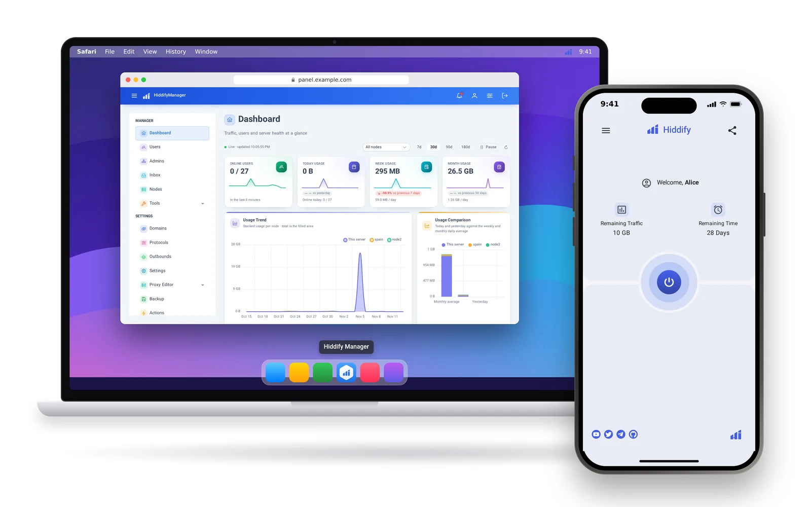
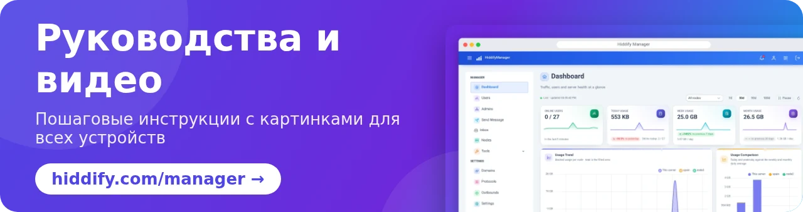

<base target="_blank">

<div dir="ltr" align=center>

[**English 🇬🇧**](../README.md) / [**فارسی 🇮🇷**](README_fa.md) / [**简体中文 🇨🇳**](README_cn.md) &nbsp;&nbsp; [](https://hiddify.com/manager/) [](https://github.com/hiddify/hiddify-manager/discussions/categories/q-a-%D8%B3%D9%88%D8%A7%D9%84%D8%A7%D8%AA-%D8%B1%D8%A7%DB%8C%D8%AC) [](https://github.com/hiddify/hiddify-manager/issues)

</div>
<br>

<div align=center>


</div>
<br>

<div align=center>

[](https://www.pepy.tech/projects/hiddifypanel) [](https://github.com/hiddify/hiddify-manager/releases) [](https://github.com/hiddify/hiddify-manager/releases) [](https://github.com/hiddify/hiddify-manager/commits/) [](https://www.youtube.com/@hiddify) [](https://telegram.dog/hiddify) [](https://telegram.dog/hiddify_board/5) [](https://gurubase.io/g/hiddify-manager)

</div>

<div dir="ltr" markdown="1">

## Добро пожаловать в Hiddify Manager

Hiddify Manager — это бесплатная панель с открытым исходным кодом для обхода цензуры, которую вы устанавливаете на свой собственный сервер. Она запускает многопользовательский VPN- и прокси-сервер с **более чем 20 протоколами**, включая **Reality** и **Telegram-прокси**, и даёт вам современную веб-панель для управления пользователями, доменами и настройками. Панель оптимизирована для работы в условиях жёсткой фильтрации в **Иране, Китае и России** и указана в списке панелей [Xray](https://github.com/XTLS/Xray-core#installation).

<div align=center>

</div>

### Содержание

- [Быстрая установка](#быстрая-установка)
- [Почему Hiddify Manager?](#почему-hiddify-manager)
  - [Основные возможности](#основные-возможности)
  - [Поддерживаемые протоколы](#поддерживаемые-протоколы)
- [Установка и руководства](#установка-и-руководства)
- [Благодарности](#благодарности)
- [Пожертвования и поддержка](#пожертвования-и-поддержка)
- [Сотрудничество и контакты](#сотрудничество-и-контакты)

## Быстрая установка

Вам понадобится сервер (VPS) с **Ubuntu 22.04, 24.04 или 26.04** (amd64 или arm64), не менее **1 ГБ оперативной памяти, 1 ядром процессора и 10 ГБ дискового пространства**. Подключитесь к серверу по SSH и выполните:

```bash
bash <(curl https://i.hiddify.com/release)
```

В конце установщик покажет ссылку на панель администратора. Откройте её, пройдите быструю настройку и добавьте первого пользователя. В [руководстве по установке](https://hiddify.com/manager/installation-and-setup/guide/) подробно описан каждый шаг; есть также руководства по установке в один клик для [Hetzner](https://hiddify.com/manager/installation-and-setup/Quick-installation-on-Hetzner-Servers/), [Oracle Cloud](https://hiddify.com/manager/installation-and-setup/Quick-Installation-on-Oracle-Cloud/), [Azure](https://hiddify.com/manager/installation-and-setup/Quick-Installation-on-Microsoft-Azure/) и [cloud-init](https://hiddify.com/manager/installation-and-setup/Cloud-init-installation/).

Для подключения с телефонов и компьютеров мы рекомендуем [приложение Hiddify](https://github.com/hiddify/hiddify-app).

## Почему Hiddify Manager?

Название *Hiddify* образовано от слов **hidden** (скрытый) и **simplify** (упрощать): наша цель — сервер, который трудно обнаружить и легко обслуживать.

### Основные возможности

- 🖥 **Современная панель администратора (Admin V2)** на 28 языках, со светлой и тёмной темами, удобная и на телефоне.
- ⚡ **Быстрая установка** и пошаговая первоначальная настройка; **автоматические обновления** и **автоматическое резервное копирование** (копии также приходят вам в Telegram).
- 🧠 Ядра **Xray и sing-box** вместе, с **умной маршрутизацией**, при которой местные сайты открываются без прокси.
- 🌐 **Любые типы доменов:** прямые, CDN (Cloudflare и другие), relay, домены только для подписки, Reality, fake и wildcard-домены; автоматическое получение сертификатов.
- 👥 **Управление пользователями:** ограничения по трафику и сроку для каждого пользователя, продление, теги и **три роли администраторов** (суперадминистратор, администратор, агент) с индивидуальными ограничениями.
- 📱 **Личная страница** для каждого пользователя: расход трафика, конфигурации, QR-коды и импорт в один клик в приложение Hiddify и другие клиенты.
- 🤖 **Telegram-бот** для вас и ваших пользователей: создание пользователей и управление ими, состояние сервера, бесплатные тестовые аккаунты, напоминания и сообщения в поддержку.
- ✈️ **Telegram-прокси** (MTProxy FakeTLS) и **веб-прокси Telegram через Cloudflare**.
- 🛰 **Несколько серверов:** подключайте несколько серверов (узлов) к одной родительской панели.
- 🧰 **Инструменты:** проверка конфигураций, сканер чистых IP, сканер доменов для Reality, WARP, файрвол, DNS через HTTPS, пользовательские исходящие подключения (outbounds) и шаблоны конфигураций.

### Поддерживаемые протоколы

**VLESS, VMess, Trojan, Reality, Shadowsocks (2022, ShadowTLS), Hysteria2, TUIC, WireGuard, AnyTLS, Snell, Naive, Mieru, SSH, xHTTP, gRPC, WebSocket, HTTPUpgrade,** DNS-туннели (**VayDNS, Slipstream, MasterDnsVPN**) и **Telegram proxy** — через прямые, CDN- и relay-домены.

## Установка и руководства

Все руководства с картинками и видео есть на нашем сайте:

- [Руководство по установке](https://hiddify.com/manager/installation-and-setup/guide/)
- [Как правильно настроить панель](https://hiddify.com/manager/configuration-and-advanced-settings/How-to-configure-Hiddify-panel-properly/)
- [Домены, CDN и Cloudflare](https://hiddify.com/manager/domain-worker-cdn-and-tunneling/How-to-use-Cloudflare-CDN/)
- [Все руководства и видео по Hiddify Manager](https://hiddify.com/manager/)

<div align="center">
 <a href="https://hiddify.com/manager/"></a>
</div>

## Благодарности

Мы искренне благодарим участников этих проектов: их надёжная основа и возможности сделали этот проект возможным:

- [sing-box](https://github.com/SagerNet/sing-box)
- [Xray](https://github.com/XTLS/Xray-core)
- [Linux от Линуса Торвальдса](https://github.com/torvalds/linux)
- Шрифт: [Vazirmatn от Сабера Растикердара](https://github.com/rastikerdar/vazirmatn)

## Пожертвования и поддержка

Самый простой способ поддержать нас — поставить этому репозиторию звёздочку (⭐) вверху страницы.

<div align=center>
<a href="https://next.ossinsight.io/widgets/official/analyze-repo-stars-history?repo_id=541755332" target="_blank" style="display: block" align="center">
  <picture>
    <source media="(prefers-color-scheme: dark)" srcset="https://next.ossinsight.io/widgets/official/analyze-repo-stars-history/thumbnail.png?repo_id=541755332&image_size=auto&color_scheme=dark" width="721" height="auto">
    
  </picture>
</a>
</div>

Нам также нужна финансовая поддержка для работы наших сервисов. Вся наша работа ведётся на добровольных началах, и каждое пожертвование идёт на развитие проекта. Подробнее — на нашей [странице пожертвований](https://hiddify.com/donation-and-support/).

## Сотрудничество и контакты

Hiddify — проект, который развивает сообщество, и нам нужна ваша помощь. Если вы разбираетесь в одной из этих областей, свяжитесь с нами и расскажите о своих навыках:

- Разработка на Python
- Разработка на Vue / TypeScript
- Разработка на Go
- Создание медиаконтента

<div align=center>
<br>

[](mailto:contribute@hiddify.com)
[](https://telegram.dog/hiddify)
[](https://telegram.dog/hiddify_board)
[](https://www.youtube.com/@hiddify)
[](https://twitter.com/intent/follow?screen_name=hiddify_com)

</div>

<p align=center>
Мы благодарим всех, кто участвует в этом проекте, — здесь, на GitHub, и многих других за его пределами. Это очень много для нас значит. ♥
</p>

<p align=center>
<a href="https://github.com/hiddify/hiddify-manager/graphs/contributors">
  
</a>
</p>
<p align=center>
Сделано с помощью <a target="_blank" href="https://contrib.rocks">Contrib.Rocks</a>
</p>

</div>
